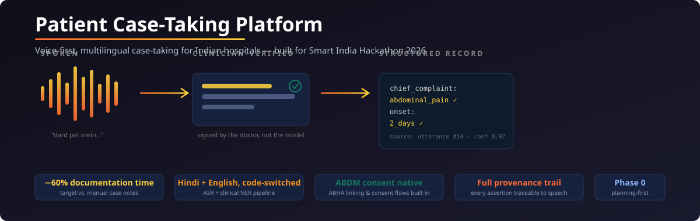
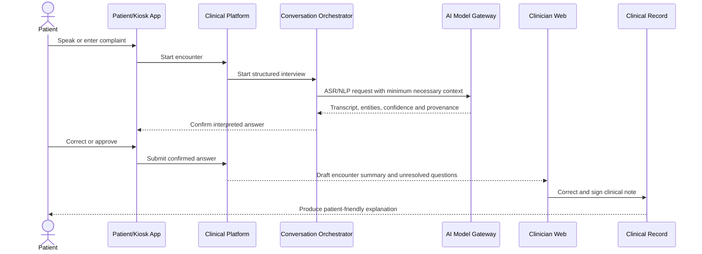

<div align="center">


</div>

<div align="center">
  
</div>

# Patient Case-Taking Platform

A multilingual, consent-driven patient case-taking platform for Indian hospitals — built for **Smart India Hackathon 2026**.

> **Reduces clinical documentation time by 60%** while preserving informed consent, clinician accountability, and patient comprehension.

---

## 🎯 Problem → ✨ Solution

| The problem | What we build |
|---|---|
| Doctors spend **40% of consultation time** on paperwork | Voice-first case-taking that structures data as the patient speaks |
| Language barriers: 22+ official languages, code-switched speech | Hindi/English code-switched ASR + clinical NER |
| Paper records lose provenance and audit trails | Signed clinical notes where every assertion traces back to a spoken utterance |
| ABDM/ABHA integration is complex and often misimplemented | Native ABDM consent flows and patient-friendly summaries in the patient's language |

The clinician stays in charge throughout: AI drafts are suggestions, and nothing enters the signed record without clinician approval.

## 🚀 Quick Start

```bash
git clone https://github.com/shivamsingh-007/NotMID.git
cd NotMID/patient-case-taking-platform

# Install dependencies (when available)
# npm install

# Start local development (when available)
# docker-compose up -d
# npm run dev
```

> **Note**: This is a planning-first repository — no production application code exists yet. Build begins after Phase 0 exit gate approval. See [`docs/plans/BUILD-ROADMAP.md`](docs/plans/BUILD-ROADMAP.md).

---

## 🔄 How It Works

Every encounter follows one loop: speak → confirm → structure → sign → explain.



<div align="center">
  
</div>

---

## 🏗️ Architecture

<div align="center">
  
</div>

### Design Principles

1. **Patient safety is a release gate**, not a backlog item
2. **Clinician remains accountable** for signed clinical content
3. **ABHA is an external identifier**, not the internal primary key
4. **PostgreSQL is the transactional and clinical source of truth**
5. **MongoDB stores flexible raw AI artifacts, never signed clinical truth**
6. **Object storage holds immutable source documents** and audio
7. **vLLM and every model service remain behind the AI gateway**
8. **Every clinical assertion retains provenance**

### Tech Stack

| Layer | Technology |
|-------|------------|
| **Frontend** | Next.js + React + TypeScript, PWA-capable shared monorepo |
| **Backend APIs** | FastAPI + Pydantic + OpenAPI |
| **Realtime & async** | WebSockets + Kafka from MVP; Redis remains cache/session state |
| **Identity** | Clerk for staff/patient web surfaces; hospital SSO where available; constrained kiosk pre-auth |
| **LLM serving** | Unified router → HiMed 8B/vLLM → smaller local summarizer → approved OpenAI/Claude fallback |
| **Speech** | AI4Bharat/Bhashini ASR + Indic/Bhashini-compatible TTS |
| **Documents & NLP** | PaddleOCR/Tesseract/TrOCR/Donut ensemble + specialist handwriting model + PyTorch clinical NLP |
| **Rules** | Versioned Python rules service; Drools-style engine only if authoring complexity justifies it |
| **Data** | PostgreSQL, MongoDB, Redis, S3-compatible object storage, derived Elasticsearch |
| **Infrastructure** | Docker; Kubernetes for pilot/production; KServe/Ray Serve optional later |
| **Standards** | FHIR R4, ABDM APIs, OpenAPI 3.1 |
| **Observability** | OpenTelemetry, Prometheus, Grafana |

---

## 💡 Impact Targets

<div align="center">
  
</div>

---

## 🗺️ Roadmap

<div align="center">
  
</div>

| Phase | Timeline | Focus |
|-------|----------|-------|
| **0 — Discovery & Governance** | 3–5 weeks | Clinical workflow observation, consent/retention policies, ABDM sandbox path, synthetic evaluation set |
| **1 — Safe Clinical Workflow MVP** | 8–12 weeks | Clerk identity boundary, FastAPI core, encounter state machine, Patient PWA / kiosk / clinician review, vLLM gateway and Hi/En ASR, clinician sign-off |
| **2 — Hospital Pilot & Async Processing** | 8–10 weeks | Hardened Kafka workflows, OCR ensemble, clinical NLP, deterministic alerts, multilingual summaries + TTS, ABDM sandbox integration |
| **3 — Multi-Facility Scale** | 12–16 weeks | Kafka worker-pool scale, Elasticsearch, facility isolation, ABDM production, adapters, autoscale, DR & failover |
| **4 — Validated Advanced Assistance** | — | Specialty interviews, care-gap suggestions, retrieval-assisted summaries with citations, de-identified analytics |

Full detail: [`BUILD-ROADMAP.md`](docs/plans/BUILD-ROADMAP.md).

---

## 👥 Team

| Role | Name |
|------|------|
| **Team Lead** | Shivam |
| **Backend Architect** | Yash |
| **Frontend Lead** | Aryan |
| **AI/ML Engineer** | Anushka |
| **DevOps & Infra** | Sakshi |
| **Clinical Safety & QA** | Tarun |

---

## 📚 Documentation

| Document | Purpose |
|----------|---------|
| [`CONTEXT-GRAPH.md`](CONTEXT-GRAPH.md) | Repository & system context |
| [`BUILD-ROADMAP.md`](docs/plans/BUILD-ROADMAP.md) | Phased delivery plan |
| [`SYSTEM-ARCHITECTURE.md`](docs/architecture/SYSTEM-ARCHITECTURE.md) | Target architecture & request flows |
| [`TRAFFIC-CONTROL-AND-MODEL-ROUTING.md`](docs/architecture/TRAFFIC-CONTROL-AND-MODEL-ROUTING.md) | NGINX, gateway, uploads, provider routing & implementation slices |
| [`SERVICE-BOUNDARIES.md`](docs/architecture/SERVICE-BOUNDARIES.md) | Logical contexts, MVP deployables & extraction triggers |
| [`DATA-OWNERSHIP.md`](docs/architecture/DATA-OWNERSHIP.md) | Sources of truth & storage rules |
| [`DATA-MODEL.md`](docs/architecture/DATA-MODEL.md) | Conceptual Postgres, MongoDB, object & AYUSH model |
| [`EVENT-CATALOG.md`](docs/contracts/EVENT-CATALOG.md) | Async event conventions |
| [`RESILIENCE-PATTERNS.md`](docs/operations/RESILIENCE-PATTERNS.md) | Dependency fallbacks, retry, cache & rollout policy |
| [`CLINICAL-AI-SAFETY.md`](docs/safety/CLINICAL-AI-SAFETY.md) | Clinical AI safety gates |
| [`SECURITY-AND-PRIVACY.md`](docs/security/SECURITY-AND-PRIVACY.md) | Consent, access & PHI controls |

## 🔒 Safety & Compliance

- **Clinical Safety**: Hazard log, test cases, approval evidence, incident review
- **Privacy**: Threat model, access reviews, key rotation, breach drills
- **Data Governance**: Migrations, quality rules, lineage, backup restoration
- **AI/ML**: Model cards, evaluation reports, drift & cost monitoring
- **Accessibility**: Field research, comprehension metrics, WCAG 2.1 AA

## 🤝 Contributing

1. Read [`CONTEXT-GRAPH.md`](CONTEXT-GRAPH.md) and relevant subsystem `README.md`
2. Review API/event contracts and architecture decisions
3. Ensure clinical-safety and privacy requirements are met
4. Write tests proportional to risk
5. Include audit/observability coverage
6. Document failure/retry behavior and rollback notes

## 📄 License

Apache License 2.0 — see [`LICENSE`](LICENSE) for details.

---

*Built for Smart India Hackathon 2026 — Patient Case-Taking Platform Team*
